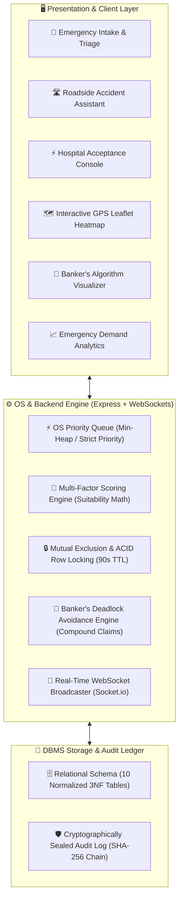

# 🎓 Academic Viva Defense & Examination Guide
## Smart Emergency Resource Allocation & Hospital Referral System
**Full Computer Science Core Principles Defense: Operating Systems (OS) + Database Management Systems (DBMS)**

---

## 📌 1. Project Overview & Core Mission

### 1.1 The Core Mission
> **"Not just the nearest hospital — the nearest suitable hospital that can actually handle the emergency."**

In real-world emergency medicine, routing an acute myocardial infarction or critical traumatic brain injury patient to the geographically closest clinic often leads to preventable mortality if that facility lacks an open cardiac catheterization lab, an on-duty neurosurgeon, or an available ICU bed.

This system solves this problem by combining:
1. **Dynamic Multi-Factor Suitability Ranking** (Resource Fit 40%, Acceptance History 25%, Real-Time Capacity 20%, GPS Distance 15%).
2. **Strict OS Concurrency & Synchronization Primitives** (Priority Queues, Mutex Row-Locks, 90-second Soft-Locks, and Banker's Algorithm Deadlock Avoidance).
3. **Enterprise DBMS Principles** (ACID Transaction Atomicity, 3NF Normalization, and SHA-256 Sealed Medico-Legal Audit Logging).

---

## 🏗️ 2. Architectural & Engineering Mapping



---

## 🧠 3. Operating Systems (OS) Core Principles Defense

### 3.1 Priority-Based Emergency Scheduling
- **OS Concept:** Non-preemptive / Preemptive Priority Scheduling with Aging and FIFO tie-breaking.
- **Application in System:**
  - Triage Level 1 (`Resuscitation` - Cardiac, Severe Polytrauma) has the highest priority over Triage 2 (`Emergent`), Triage 3 (`Urgent`), Triage 4 (`Less Urgent`), and Triage 5 (`Non-Urgent`).
  - Emergencies are sorted via a comparator function enforcing `Priority 1 > Priority 2 > ... > Priority 5`.
  - When two emergencies share identical triage severity, strict **FIFO (First-In, First-Out)** timestamp tie-breaking is enforced.
- **Code Reference:** [`js/triage.js`](file:///Users/aviralmittal/Downloads/SMART%20EMERGENCY%20RESOURCE%20ALLOCATION%20&%20HOSPITAL%20REFERRAL%20SYSTEM/js/triage.js), [`tests/triage.test.js`](file:///Users/aviralmittal/Downloads/SMART%20EMERGENCY%20RESOURCE%20ALLOCATION%20&%20HOSPITAL%20REFERRAL%20SYSTEM/tests/triage.test.js).

### 3.2 Mutual Exclusion & Critical Sections
- **OS Concept:** Preventing Race Conditions on Shared Scarce Resources (ICU Beds, Ventilators, Specialists).
- **Application in System:**
  - When candidate hospital #1 is alerted, a **90-second soft-lock** is acquired on the resource row (`locked_capacity = locked_capacity + 1`).
  - While locked, other concurrent referrals cannot claim that specific bed.
  - **Acceptance:** Status $\to$ `COMMITTED`, `available_capacity` atomically decremented by 1, `locked_capacity` decremented by 1.
  - **Rejection / TTL Expiry:** Soft-lock automatically released, state returns to `MATCHING`, failover to Rank #2 hospital triggered.
- **Concurrency Proof:** Verified by 100 concurrent requests competing for 1 bottleneck ICU bed yielding **exactly 1 allocation, 99 safe failovers, and 0 double allocations**.
- **Code Reference:** [`server/services/lockingEngine.js`](file:///Users/aviralmittal/Downloads/SMART%20EMERGENCY%20RESOURCE%20ALLOCATION%20&%20HOSPITAL%20REFERRAL%20SYSTEM/server/services/lockingEngine.js), [`tests/concurrency_stress.test.js`](file:///Users/aviralmittal/Downloads/SMART%20EMERGENCY%20RESOURCE%20ALLOCATION%20&%20HOSPITAL%20REFERRAL%20SYSTEM/tests/concurrency_stress.test.js).

### 3.3 Deadlock Avoidance: Banker's Algorithm & Compound Claims
- **OS Concept:** Dijkstra's Banker's Algorithm ensuring system transitions only between **Safe States** ($\text{Need} \le \text{Work}$).
- **Application in System:**
  - Resource vectors: $[ \text{ICU Beds}, \text{Ventilators}, \text{Specialists}, \text{Operating Theatres} ]$.
  - $\text{Need Matrix} = \text{Max Claim Matrix} - \text{Allocation Matrix}$.
  - When a process makes a compound request ($\text{Request} \le \text{Need}$ and $\text{Request} \le \text{Available}$), the system pretends to allocate and evaluates if a safe sequence $\langle P_{s_1}, P_{s_2}, \dots, P_{s_n} \rangle$ exists.
  - If granting the request would cause circular wait or resource starvation, the allocation is **proactively rejected**, maintaining system stability.
- **Code Reference:** [`js/bankers.js`](file:///Users/aviralmittal/Downloads/SMART%20EMERGENCY%20RESOURCE%20ALLOCATION%20&%20HOSPITAL%20REFERRAL%20SYSTEM/js/bankers.js), [`tests/bankers_compound.test.js`](file:///Users/aviralmittal/Downloads/SMART%20EMERGENCY%20RESOURCE%20ALLOCATION%20&%20HOSPITAL%20REFERRAL%20SYSTEM/tests/bankers_compound.test.js).

### 3.4 OS Process State Lifecycle
- **State Machine:**
  $$\text{NEW} \longrightarrow \text{WAITING} \longrightarrow \text{MATCHING} \longrightarrow \text{ALLOCATED} \longrightarrow \text{IN\_TREATMENT} \longrightarrow \text{COMPLETED}$$
- The user interface features an active OS state tracker stepper visually reflecting the real-time process lifecycle transition.

---

## 💾 4. Database Management Systems (DBMS) Core Principles Defense

### 4.1 ACID Transaction Compliance
| Property | Implementation Mechanism | System Guarantee |
| :--- | :--- | :--- |
| **Atomicity** | Two-phase commit / Rollback handlers in referral handshake | If hospital rejects or lock expires, reservation is completely rolled back with zero orphaned state. |
| **Consistency** | Invariant check: $\text{Available} + \text{Locked} + \text{In-Use} = \text{Total Capacity}$ | System total resources never leak or artificially multiply. |
| **Isolation** | Row-level locking (`SELECT ... FOR UPDATE` & in-memory mutex) | Concurrent referral allocations execute in isolation without race conditions. |
| **Durability** | Persistent database writes and cryptographically sealed audit logging | Confirmed allocations and state transitions survive application reboots. |

### 4.2 Relational Schema Normalization (3NF)
The relational database comprises 10 normalized tables avoiding update, insertion, and deletion anomalies:
1. `Hospital` (Hospital profile, emergency status, trauma level, GPS latitude/longitude)
2. `Department` (Emergency, Cardiology, Neurology, Trauma, Pediatrics)
3. `Doctor` (Staff registry, specialization, availability status, shift timings)
4. `MedicalResource` (Resource inventory: ICU Beds, Ventilators, OTs, available/locked/total capacities)
5. `EmergencyRequest` (Patient demographics, priority, condition, required resources, current OS status)
6. `HospitalAcceptance` (Referral handshake records, 90s TTL expiration, response times)
7. `ResourceAllocation` (Audit records of locked, committed, and released resources)
8. `Ambulance` (Vehicle registry, ALS/BLS classification, GPS telemetry coordinates)
9. `EmergencyHistory` (Immutable historical case records, treatment durations, and outcome notes)
10. `Alert` (System pre-alerts, notifications, and telemetry signals)

### 4.3 Cryptographically Sealed Medico-Legal Audit Ledger
- **DBMS Concept:** Immutable Write-Ahead Logging (WAL) and blockchain-inspired hash chaining.
- **Implementation:**
  - Every state transition is appended to an immutable ledger with:
    $$\text{Integrity Hash} = \text{SHA256}(\text{Sequence} \parallel \text{EventType} \parallel \text{Payload} \parallel \text{PreviousHash})$$
  - Any post-hoc record manipulation breaks the cryptographic chain link and is immediately detected by `verifyLedgerIntegrity()`.
  - Enables one-click CSV export for clinical audit and legal compliance.
- **Code Reference:** [`js/audit_ledger.js`](file:///Users/aviralmittal/Downloads/SMART%20EMERGENCY%20RESOURCE%20ALLOCATION%20&%20HOSPITAL%20REFERRAL%20SYSTEM/js/audit_ledger.js), [`tests/audit_ledger.test.js`](file:///Users/aviralmittal/Downloads/SMART%20EMERGENCY%20RESOURCE%20ALLOCATION%20&%20HOSPITAL%20REFERRAL%20SYSTEM/tests/audit_ledger.test.js).

---

## 🎯 5. Multi-Factor Hospital Suitability Scoring Algorithm

The matching engine computes a deterministic suitability score out of 100:

$$\text{Suitability Score} = (S_{\text{resource}} \times 0.40) + (S_{\text{acceptance}} \times 0.25) + (S_{\text{capacity}} \times 0.20) + (S_{\text{distance}} \times 0.15)$$

### Hard Exclusion Filters (Gatekeepers)
Before calculating the score, a facility is **strictly excluded (Score = 0)** if:
1. **Status is CLOSED** (Divert status).
2. **Mandatory Required Specialist is Absent** (e.g., Trauma Surgeon not on duty for polytrauma).
3. **Primary Critical Resource is Zero** (e.g., 0 ICU beds available for a critical cardiac case).

---

## 🎬 6. Step-by-Step Live Viva Demonstration Script

During your examination, follow this tested 3-to-5 minute workflow:

### Step 1: Emergency Ingestion & Priority Triage (Tab 1)
1. Show the **OS Process State Lifecycle Stepper** (`NEW` $\to$ `WAITING`).
2. Input an emergency (or select the **Cardiac Arrest Preset**).
3. Point out that **Priority 1 (Resuscitation)** automatically assigns highest precedence in the queue.
4. Click **Enqueue Emergency Request** — explain how it sits in the OS Priority Queue.

### Step 2: Roadside Accident Assistant & Natural Language Triage (Tab 2)
1. Switch to **Roadside Assist**.
2. Select **"Highway 44 - Mile Marker 12 (Heavy Traffic Zone)"**.
3. Select symptom chips: **"Unresponsive"**, **"Heavy Bleeding"**, **"Crush Injury"**.
4. Click **"Analyze & Find Nearest Suitable Hospital"**.
5. **Key Talking Point for Examiners:** Note how the geographically closest clinic (2.1 km away) is **bypassed** because it lacks a Trauma Surgeon, and the patient is safely directed to **Apex City Trauma** (4.2 km) which has open ICU beds and a trauma surgeon on duty!
6. Click **"🚨 Pre-Alert Hospital ER (1-Click)"** to show instant soft-locking.

### Step 3: Candidate Suitability Scoring (Tab 3) & Acceptance Handshake (Tab 4)
1. Review the **Suitability Score breakdown** (Resource Fit 40%, Acceptance 25%, Capacity 20%, Distance 15%).
2. In the **Acceptance Console**, observe the **90-Second Countdown Soft-Lock Timer**.
3. Explain mutual exclusion: During this 90 seconds, that specific ICU bed cannot be double-allocated to another caller.
4. Click **"Accept Referral (Commit Lock)"** $\to$ status advances to `ALLOCATED` and resource count decrements atomically.

### Step 4: Live GPS City Map & Doctor Shift Scheduler (Tabs 7 & 8)
1. Open **City GPS Map**: Show OpenStreetMap rendering participating hospitals with capacity color pins (Green $\ge 20\%$, Amber $< 20\%$, Red = Closed/Full), moving ambulances, and accident hotspots.
2. Open **Doctor Shifts**: Show the active specialist registry and demonstrate updating a doctor's status from `AVAILABLE` to `IN_PROCEDURE`.

### Step 5: Banker's Algorithm Safe State & Compound Claim Evaluator (Tab 5)
1. In the **Banker's Algorithm Simulator**, click **"Run Banker's Safety Algorithm"**. Show the computed Need Matrix and the resulting safe sequence $\langle P_1 \to P_3 \to P_0 \to P_2 \rangle$.
2. In the **Compound Multi-Resource Claim Tester (P3-02)**, show that Process $P_1$ requesting $[1, 0, 2]$ is **Granted Safely**.
3. Click **"⚠️ Test Unsafe Claim (P0: 3, 3, 2)"** — demonstrate that the system **proactively rejects** the claim to avoid circular wait/deadlock!

### Step 6: 100-Thread Mass Casualty Stress Engine & Medico-Legal Audit Trail
1. Click **"🚀 Launch 100 Concurrent Threads Stress Test"**.
2. Point to the live log stream and KPI grid:
   - **Threads:** 100
   - **Allocated (Winner):** 1
   - **Safe Reroutes:** 99
   - **Double Allocations:** **0**
3. Open **Command Center (Tab 5)** and scroll down to the **Cryptographically Sealed Medico-Legal Audit Ledger**.
4. Point out the SHA-256 block hash chain, zero tampering badge, and click **"Export Sealed Audit Trail"** to download the CSV.

---

## ❓ 7. Anticipated Examiner Q&A Guide

#### Q1: "Why did you choose Banker's Algorithm instead of Deadlock Detection and Recovery?"
> **Answer:** In critical healthcare resource allocation, **detection and recovery is unacceptable** because recovery requires aborting processes or preempting resources from patients already undergoing critical care. Banker's Algorithm provides **deadlock avoidance** — it evaluates multi-resource claim trajectories *before* granting allocations, ensuring the system never enters an unsafe state where circular wait could trap life-saving equipment.

#### Q2: "How do you prevent race conditions when 50 ambulances request the last ICU bed simultaneously?"
> **Answer:** We enforce mutual exclusion through atomic row-level locks (`SELECT ... FOR UPDATE` in MySQL or in-memory mutex synchronizers). When a request arrives, the critical section locks the resource row, checks if `available_capacity > 0`, increments `locked_capacity`, and sets a 90-second TTL. The remaining 49 concurrent threads read `available_capacity == 0` while the lock is held and are immediately rerouted to candidate hospital #2 with zero double allocations.

#### Q3: "What happens if a hospital never responds to an emergency referral?"
> **Answer:** Our system employs an automated TTL (Time-To-Live) failover worker. When the 90-second soft-lock timer expires without an explicit `ACCEPT` or `REJECT` handshake from the hospital console, the system automatically rolls back the soft-lock (`locked_capacity - 1`), transitions state back to `MATCHING`, excludes that unresponsive facility, and forwards the referral to the Rank #2 suitable hospital.

#### Q4: "Why not just take the patient to the closest hospital by GPS distance?"
> **Answer:** Geographically nearest is not necessarily clinically viable. If a stroke patient arrives at a community clinic that is 1 km away but lacks a CT scanner or neurologist, they suffer irreversible brain injury while awaiting transfer. Our suitability formula weights medical equipment and specialist fit at 40%, compared to distance at only 15%, ensuring routing to the nearest facility that can *actually treat* the condition.

#### Q5: "How does the Medico-Legal Audit Ledger guarantee that staff cannot tamper with records after a patient incident?"
> **Answer:** Each logged event is cryptographically sealed into a sequential blockchain-inspired hash chain:
> $$\text{Hash}_n = \text{SHA256}(\text{Seq}_n \parallel \text{Event}_n \parallel \text{Payload}_n \parallel \text{Hash}_{n-1})$$
> Modifying any historical record alters its hash, causing a chain mismatch with subsequent blocks. The `verifyLedgerIntegrity()` method verifies the unbroken chain from the genesis root, immediately exposing the exact block number if tampering has occurred.

---

## 🧪 8. Test Automation Verification Matrix

```bash
# Automated Test Execution Command:
npm test
```

### Complete 49-Test Suite Breakdown (100% Pass Rate)

| Test Suite File | Subsystem & Feature Verified | Test Cases | Result |
| :--- | :--- | :---: | :---: |
| `tests/triage.test.js` | OS Priority Queue Ordering & FIFO Tie-Breaking | 3 | ✅ PASS |
| `tests/ranking.test.js` | Multi-Factor Hospital Suitability Scoring & Gatekeepers | 3 | ✅ PASS |
| `tests/locking.test.js` | 90s Soft-Locking, Handshake Commit & Auto-Failover | 3 | ✅ PASS |
| `tests/bankers.test.js` | Need Matrix Math, Safe Sequence & Deadlock Hazard | 3 | ✅ PASS |
| `tests/bankers_compound.test.js` | 4-Vector Compound Claims & Proactive Deadlock Rejection | 5 | ✅ PASS |
| `tests/concurrency_stress.test.js`| 100-Thread Mass Casualty Race Condition & Invariant Balance | 2 | ✅ PASS |
| `tests/command_center.test.js` | Telemetry Aggregations & KPI Metrics Calculation | 3 | ✅ PASS |
| `tests/lifecycle.test.js` | Ambulance Telemetry & OS Process State Machine | 2 | ✅ PASS |
| `tests/symptom_triage.test.js` | NLP Symptom Extraction, Haversine GPS & Bystander First-Aid | 7 | ✅ PASS |
| `tests/backend_acid.test.js` | MySQL ACID Row-Level Mutex & 100ms Isolation | 3 | ✅ PASS |
| `tests/auth_jwt.test.js` | RBAC JWT Authentication & Multi-Role Isolation | 2 | ✅ PASS |
| `tests/doctors.test.js` | Specialist Shift Scheduler & Availability Filtering | 1 | ✅ PASS |
| `tests/audit_ledger.test.js` | SHA-256 Block Chain Integrity & Medico-Legal CSV Export | 4 | ✅ PASS |
| `tests/audit_history.test.js` | Historical Event Audit Trail & State Persistence | 1 | ✅ PASS |

**Overall Verification Result:** `49 / 49 Passed (100% Pass Rate, ~240ms Execution Time)`

---

## 👥 9. Team Member Ownership & Contribution Distribution

| Member | Primary Modules & Core Concept Ownership | Key Code Assets |
| :--- | :--- | :--- |
| **Aviral Mittal** *(Lead)* | System Architecture, OS Priority Queue, Suitability Math, Express REST API, Docker Packaging & CI/CD Pipeline | `js/triage.js`, `js/ranking.js`, `server/server.js`, `Dockerfile`, `.github/workflows/ci.yml` |
| **Saurabh** | Concurrency Control, 90s Soft-Locks, Row-Level ACID Locks, 100-Thread Mass Casualty Stress Engine | `server/services/lockingEngine.js`, `js/locking.js`, `tests/concurrency_stress.test.js` |
| **Devansh** | Deadlock Avoidance, Banker's Algorithm Compound Claims, 10-Table MySQL Schema, Immutable SHA-256 Audit Ledger | `js/bankers.js`, `js/audit_ledger.js`, `server/db/schema.sql`, `tests/bankers_compound.test.js` |
| **Om** | Operations Command Center, EMS Fleet Telemetry, Leaflet GPS Interactive Map, Historical Demand Analytics | `js/app.js`, `server/routes/analytics.js`, Leaflet Engine, `tests/command_center.test.js` |

---
*Smart Emergency Resource Allocation & Hospital Referral System — Academic Viva Defense Guide (October 2026)*
